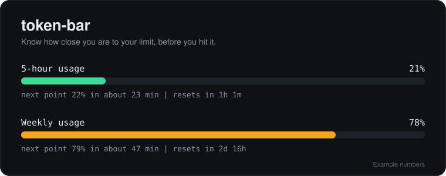

<p align="center">
  
</p>

<h1 align="center">token-bar</h1>

<p align="center"><b>Know how close you are to your AI coding limit, before it stops your work.</b></p>

<p align="center">
  <a href="LICENSE"></a>
  
  
  
  <a href="https://github.com/56steve/Token-Bar/stargazers"></a>
</p>

---

## The problem

You're deep in a task. Claude Code or Codex is mid-edit. Then a usage limit hits and the work stops. The meter that would have warned you is buried in a settings page you never open.

**token-bar puts that meter where you already are.** Ask your coding agent for your usage, and it tells you how far along you are, how fast you're going, and when the limit resets.

## What you get

- **Where you stand.** Your usage as a percent, for each limit window.
- **When the next point lands.** An estimate of how long until your usage ticks up to the next percent, based on how fast you've been working.
- **When it resets.** A countdown to the next reset.
- **Zero cloud.** It reads files already on your machine. No account, no network calls, nothing sent anywhere.

## See it

**Claude Code**

```
> /token-bar:token

5-hour usage   21%
  Next point   22% in about 23 min
  Resets       in 1h 1m

Weekly usage   78%
  Next point   79% in about 47 min
  Resets       in 2d 16h
```

**Codex**

```
> show my Codex usage limits

Monthly usage   3%
  Next point   4% in about 6 min
  Resets       in 29d 23h

Source: Codex session log, saved 2 min ago. Plan: go.
```

*Numbers above are examples.*

## Install

<details open>
<summary><b>Claude Code</b> (two commands, inside Claude Code)</summary>

<br>

```
/plugin marketplace add 56steve/Token-Bar
/plugin install token-bar --marketplace 56steve/Token-Bar
```

Then run `/token-bar:token`.

The first time, it asks one question: **do you want live numbers?** Say yes, and it adds a status line to your Claude settings so Claude reports your real percentages to token-bar. After that you never type a number. Say no, and it asks for the percent Claude shows you once, then estimates from there.

It only changes the one status line setting, and it never replaces a status line you already have.

</details>

<details open>
<summary><b>Codex</b> (two commands, nothing to set up)</summary>

<br>

```bash
codex plugin marketplace add 56steve/Token-Bar
codex plugin add token-bar@token-bar
```

Then ask Codex: **"show my Codex usage limits"**.

Codex already writes your limits into its own session logs, so token-bar just reads them.

</details>

## Works with

| Tool | Status | Where the numbers come from |
| :- | :- | :- |
| **Claude Code** | Supported | Claude's own percentages through the status line, or an estimate from your session logs |
| **Codex** | Supported | The limits Codex records in its own session logs |
| Gemini CLI | Not yet | Its files record tokens but not your limit, so any number would be a guess |
| Cursor | Not yet | Its usage lives on Cursor's servers, not on your machine |

Want your tool here? The recipe is small: find where it records usage, and read it. See [Contributing](#contributing).

## Good to know

- **Live Claude numbers need a Claude.ai Pro or Max account.** Claude only reports your limits to the status line on those accounts. API-key users get the estimate instead.
- **Readings update while you use the tool.** token-bar shows how old each reading is, and it skips the next-point estimate when a reading is old.
- **Codex reports whole percents,** so its next-point estimate is approximate.
- **Needs Python 3.** macOS includes it. Windows users may need to install it first.

## FAQ

<details>
<summary><b>Is it safe? Where does my data go?</b></summary>

<br>

Nowhere. token-bar makes no network calls and has no account. It reads each tool's own local session files and writes only its own small settings file. The code is short and open, so you can read all of it.

</details>

<details>
<summary><b>Why does Claude Code ask me to say yes once?</b></summary>

<br>

Claude Code only hands your real limits to the status line, and a plugin can't turn the status line on by itself. It has to live in your own settings, so token-bar asks before changing them. It won't replace a status line you already have.

</details>

<details>
<summary><b>I already have a status line. Can I still get live numbers?</b></summary>

<br>

Yes. token-bar leaves yours alone and prints one line you can add to your own status line script. That line passes the same data to token-bar.

</details>

<details>
<summary><b>How accurate is it?</b></summary>

<br>

With live numbers on (Claude) or on Codex, the percents are the ones the tools themselves report. The next-point and reset times come from those numbers and your recent pace, so treat them as estimates. Without live numbers, the Claude estimate depends on the last percent you gave it.

</details>

## Terminal version

This repo also has a Rust command-line tool for the Claude numbers, for people who prefer a terminal:

```bash
cargo install --git https://github.com/56steve/Token-Bar token-bar
token-bar
```

## Not affiliated with Anthropic or OpenAI

token-bar is an independent open-source project. It is not made by, endorsed by, or affiliated with Anthropic or OpenAI. Claude, Claude Code, and Codex are their makers' products.

## Contributing

Issues and pull requests are welcome, especially readers for other tools. Each tool is one small Python file that finds the tool's usage records and prints them:

- [`plugins/token-bar/scripts/token_bar.py`](plugins/token-bar/scripts/token_bar.py) for Claude Code
- [`plugins/token-bar-codex/skills/token-bar/scripts/codex_usage.py`](plugins/token-bar-codex/skills/token-bar/scripts/codex_usage.py) for Codex

Run the tests with:

```bash
cd plugins/token-bar && python3 -m unittest discover -s tests
cd plugins/token-bar-codex && python3 -m unittest discover -s tests
```

## License

MIT. See [LICENSE](LICENSE).
