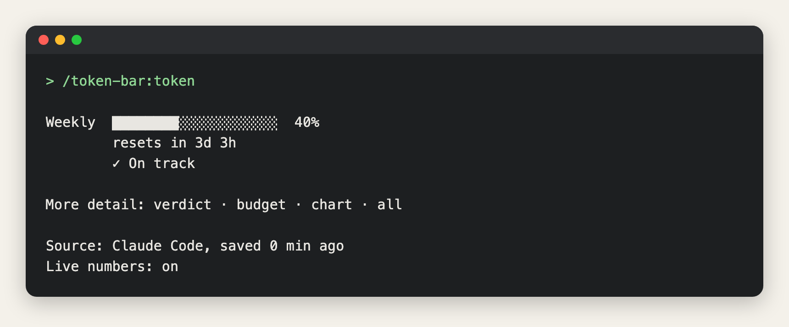
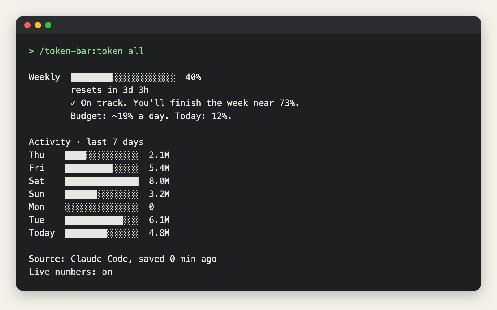
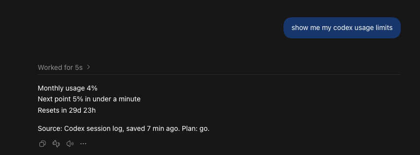

# token-bar

Ask your coding agent how close you are to your usage limit.

token-bar is a plugin for **Claude Code** and **Codex**. It reads the usage numbers each tool already keeps on your machine, and tells you:

- **where you stand**: the percent used for each limit window
- **when the next point lands**: an estimate of how long until the percent goes up by one, based on how fast you've been working
- **when it resets**: a countdown to the next reset
- **whether you'll make it**: a plain verdict on your pace, and how much you can use per day to last until the reset

It makes no network calls and needs no account.

[](https://github.com/56steve/Token-Bar/actions/workflows/ci.yml)
[](LICENSE)


## What it looks like

The first answer is short: the bar, when it resets, and a one-line headline.



Ask for more and it opens the details: the pace verdict, a daily budget, and a 7-day chart.



## Install

### Claude Code

Run these two commands inside Claude Code:

```
/plugin marketplace add 56steve/Token-Bar
/plugin install token-bar --marketplace 56steve/Token-Bar
```

Then run `/token-bar:token`. Claude Code always puts a plugin's name in front of its commands, so that's the full name. After your first numbers, token-bar offers to add a short `/token` for you. Say yes, and it adds one small skill to your own skills folder that hands off to the plugin. It never replaces a `/token` skill you wrote yourself, and it keeps working after plugin updates.

The first time, it asks where you use Claude Code: a terminal or the desktop app.

- **Terminal.** It offers live numbers. It adds a status line to your Claude settings, so Claude reports your real percentages to token-bar, and after that you never type a number. It only changes that one setting, and it never replaces a status line you already have.
- **Desktop app.** The status line doesn't run there, so it asks once for the percent Claude shows you and when it resets, then estimates from there. You can correct it any time by telling it the percent the app shows.
- **Ultra plan.** Ultra has no 5-hour limit, so it only asks about the weekly one.

The answer is short, with the values filled in from your own usage:

```
<window>  <bar>  <percent>% → <next percent>% in ~<minutes>
          resets in <time>
          <one-line headline>

More detail: <sections you can open>
Source: <where the numbers came from>
```

### Update

To pick up a new version, run these two commands inside Claude Code, then restart it:

```
/plugin marketplace update token-bar
/plugin update token-bar@token-bar
```

Or from a terminal:

```bash
claude plugin marketplace update token-bar
claude plugin update token-bar@token-bar
```

### Codex

Run these two commands in a terminal:

```bash
codex plugin marketplace add 56steve/Token-Bar
codex plugin add token-bar@token-bar
```

Then ask Codex: **show my Codex usage limits**.



*A real answer from Codex with the plugin installed.*

There is nothing to set up. Codex already writes your limits into its own session logs, and token-bar reads them. The answer shows each window as a bar with its percent, an estimate of when it next goes up, when it resets, and how old the reading is.

## More than a percent

- **Will you make it to the reset?** Under the reset time, token-bar says whether your current pace reaches the limit first, for example "at this pace you'd hit 100% in ~1h 5m, about 35 min before the reset", or where you'll end up, such as "you'll reach ~41% by the reset". This version only shows for windows that reset within 6 hours, because a pace measured over an hour says little about a window that lasts days. For the weekly limit, the pace verdict below uses your average pace over the week instead.
- **Short by default, details on request.** The first answer is just the bars with a one-line headline. A `More detail` line lists what you can open, and you ask for it in plain words ("show my budget", "show the chart") or with `/token-bar:token budget`, `verdict`, `chart` or `all`.
- **Are you on pace?** For the weekly limit, a one-line verdict sits under the bar: "✓ On track", "◐ Tight", or "⚠ Using it too fast", with the time you'd run out.
- **How much can you use per day?** A one-line budget turns what's left into a daily number, for example "Budget: ~18% a day. Today: 25%, over budget." It says how much you've used today when it knows. On the last day it counts the hours left instead.
- **Which days were heavy?** One bar per day for the last 7 days, longest for your busiest day, with the tokens beside it. An empty bar is a day with no use. It's built from your Claude Code logs, so it shows the shape of your week, not exact usage.
- **What's using your limit?** Run `/token-bar:token breakdown` in Claude Code, or ask Codex "what is using my Codex limit?". You get the share of tokens by project and by model. In Claude Code it also splits out what your subagents used. These are shares of the tokens counted from the logs, not exact shares of your limit, because the tools weigh tokens in ways the logs don't show.
- **A heads-up before you hit the wall (Claude Code).** A small hook tells you once when a window first crosses 80% and again at 90%, and stays quiet otherwise. With live numbers it uses them. In the desktop app it uses your synced estimate and says so ("Weekly usage is around 82% (estimate)"). It only warns from an estimate you have synced at least once, because an unsynced one can be well off and a false alarm is worse than none. Set `TOKEN_BAR_NO_WARN=1` to turn it off. Its logic is tested, but I haven't confirmed that hooks run in the desktop app: run `token_bar.py hook-check` after sending a message to see whether it has run.

## Supported tools

| Tool | Status | Where the numbers come from |
| :- | :- | :- |
| Claude Code | Supported | Claude's own percentages through the status line, or an estimate from your session logs |
| Codex | Supported | The limits Codex records in its own session logs |

## Good to know

- **On Ultra, there is no 5-hour limit, only a weekly one.** With live numbers, token-bar sees that Claude reports no 5-hour window and simply shows the weekly bar, with where your average pace this week would end up. Without live numbers, tell the agent you're on Ultra (or run `token_bar.py weekly-only`) and it will only ask about the weekly limit. Run `weekly-only off` to undo it.
- **The desktop app shows an estimate, and you can sync it in one step.** Live numbers come from Claude Code's status line, which runs in a terminal and not in the Claude desktop app. In the desktop app, token-bar estimates from your session logs, which can be a few points off because Claude also counts usage the logs can't see. Tell the agent the percent the app shows ("the app says 63%"), or run `token_bar.py sync 63`, and it re-syncs to that number and keeps your saved reset time. Each sync becomes an anchor: the estimate is your last synced percent plus the usage since, so it can only drift by what you used since you last synced, not across the whole week. The note under the estimate says how long ago you synced, and says so when it has been long enough to drift.
- **Live Claude numbers need a Claude.ai Pro or Max account.** Claude only reports your limits to the status line on those accounts. API-key users get the estimate instead.
- **The first run can take a few seconds, then it's fast.** Your session logs can add up to gigabytes. token-bar reads them once, then remembers how far it got in each file in `~/.claude/token-bar/scan_cache.json` and reads only what was added since. Delete that file to start fresh.
- **Readings update while you use the tool.** token-bar shows how old each reading is, and it skips the next-point estimate when a reading is old.
- **Codex reports whole percents,** so its next-point estimate is approximate.
- **Needs Python 3.** macOS includes it. Windows users may need to install it first.

## FAQ

**Where does my data go?**
Nowhere. token-bar reads each tool's own local session files and writes only its own small settings file. It never sends anything out.

**Why does Claude Code ask me to say yes once?**
Claude Code only hands your real limits to the status line, and a plugin can't turn the status line on by itself. It lives in your own settings, so token-bar asks before changing it.

**I already have a status line. Can I still get live numbers?**
Yes. token-bar leaves yours alone and prints one line you can add to your own status line script. That line passes the same data to token-bar.

**How accurate is it?**
The percents are the ones the tools report. The next-point and reset times come from those percents and your recent pace, so treat them as estimates. Without live numbers, the Claude estimate depends on the last percent you gave it.

## Terminal version

This repo also has a Rust command-line tool for the Claude numbers:

```bash
cargo install --git https://github.com/56steve/Token-Bar token-bar
token-bar
```

It shows the percent, the next point and the reset time. The plugin has the newer parts: the pace verdict, the daily budget, the 7-day chart, `sync`, and the Ultra weekly-only mode.

## Not affiliated with Anthropic or OpenAI

token-bar is an independent open-source project. It is not made by, endorsed by, or affiliated with Anthropic or OpenAI. Claude, Claude Code, and Codex are their makers' products.

## Contributing

Issues and pull requests are welcome, especially readers for other tools. **Start with [CONTRIBUTING.md](CONTRIBUTING.md)**: it covers the one rule (token-bar never sends anything out), how to set up and test, the style, and how to add a tool.

Each tool is one small Python file that finds the tool's usage records and prints them:

- [`plugins/token-bar/scripts/token_bar.py`](plugins/token-bar/scripts/token_bar.py) for Claude Code
- [`plugins/token-bar-codex/skills/token-bar/scripts/codex_usage.py`](plugins/token-bar-codex/skills/token-bar/scripts/codex_usage.py) for Codex

Run the tests with:

```bash
cd plugins/token-bar && python3 -m unittest discover -s tests
cd plugins/token-bar-codex && python3 -m unittest discover -s tests
```

## License

MIT. See [LICENSE](LICENSE).
